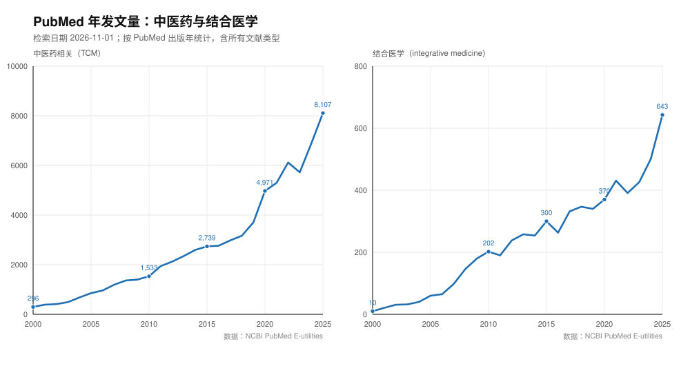
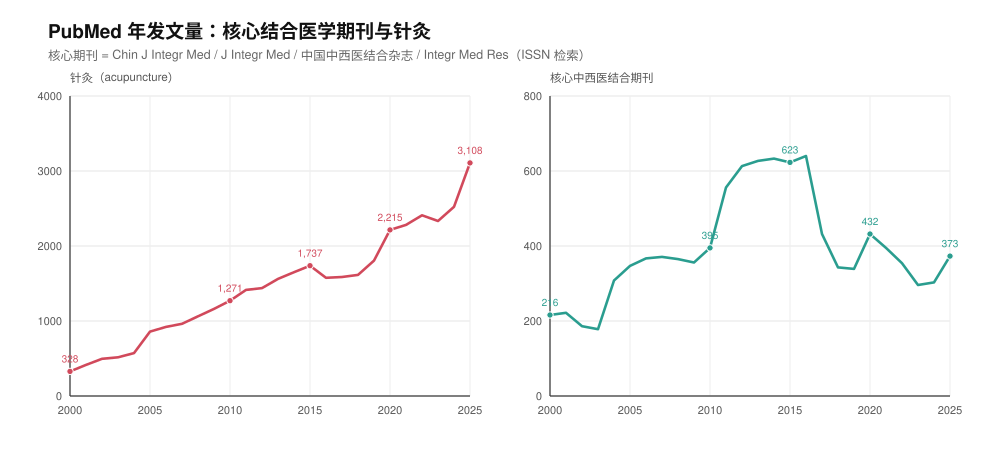
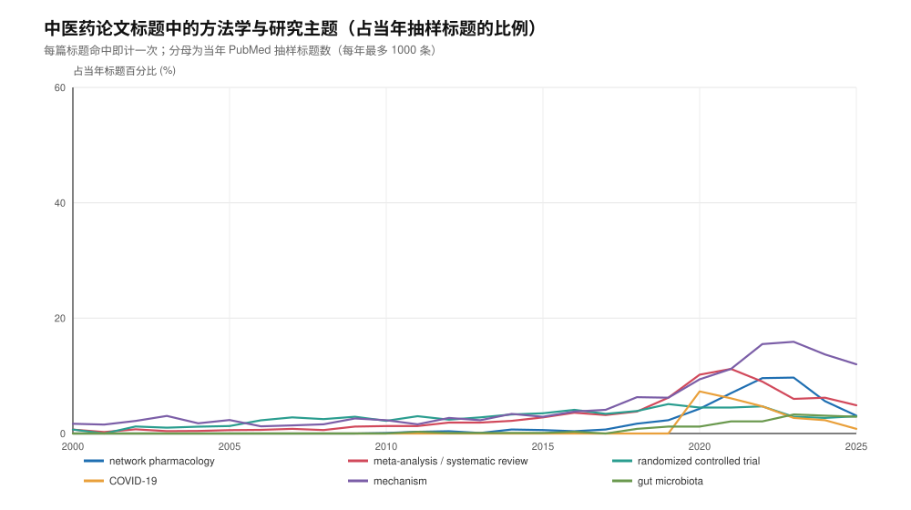
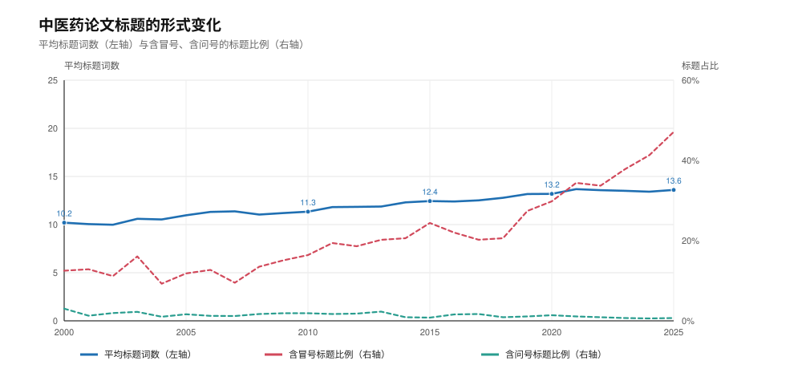
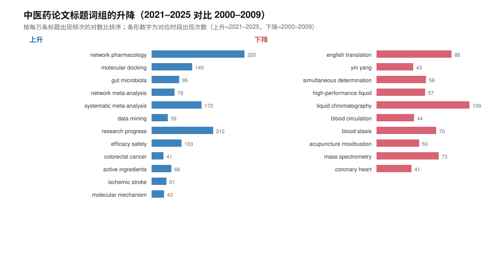
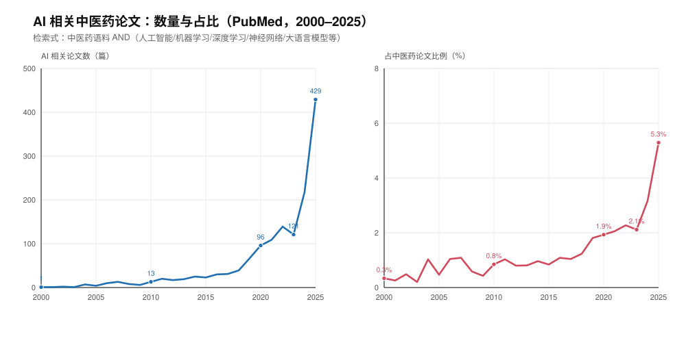
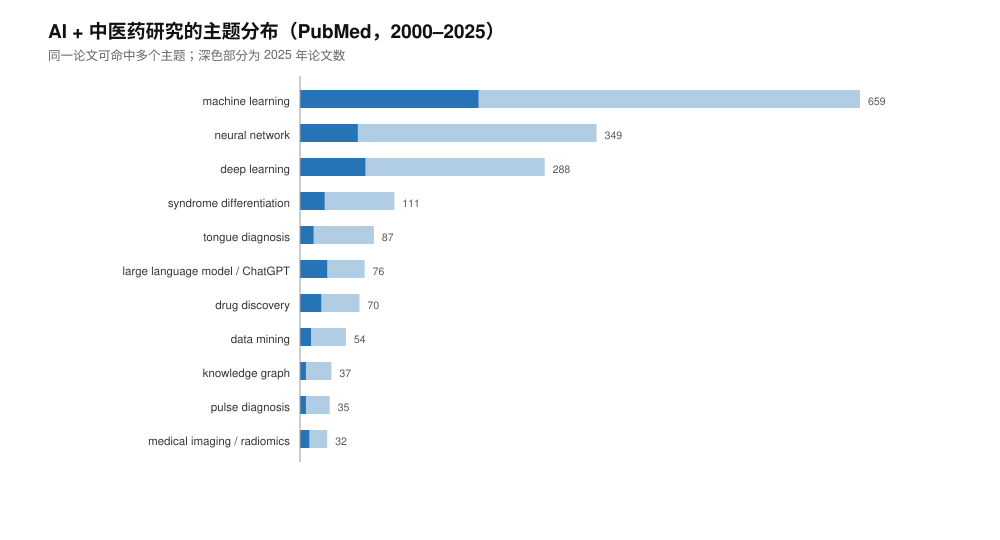

# 中西医结合论文：期刊推荐、经典文献与趋势分析

> 一份面向临床医生、研究生与科研人员的实用调研。检索、统计与论文下载完成于 **2026-11-01**。
> 复现脚本在 `scripts/`，原始数据在 `data/`，图表在 `figures/`，开放获取论文 PDF 在 `papers/`。

## 摘要

1. **发在哪里**：中西医结合没有唯一“对口刊”。按稿件类型分流：临床/循证投 *Chinese Journal of Integrative Medicine*、*Journal of Integrative Medicine*；中药药理与机制投 *Phytomedicine*、*Journal of Ethnopharmacology*、*Chinese Medicine*；针灸投 *Acupuncture in Medicine*；中文临床与共识投《中国中西医结合杂志》《中医杂志》。本文给出 11 本英文刊 + 4 本中文核心刊的对比表，以及 2021–2025 年各刊 PubMed 年发文量。
2. **经典论文**：已下载 **14 篇开放获取（CC BY）论文**，覆盖临床证据、诊疗指南、WHO 政策、网络药理学与中药数据库、AI 五类，均附 DOI、被引次数与本地 PDF。受版权限制，中文经典多需通过 CNKI/万方机构订阅获取，本文只给线索、不提供下载。
3. **数量走向**：2000–2025 年 PubMed 中，中医药相关论文由 296 篇增至 8,107 篇（27.4 倍），结合医学（integrative medicine）由 10 篇增至 643 篇（64.3 倍），针灸由 328 篇增至 3,108 篇（9.5 倍）。2020 年因 COVID-19 出现一次跳升，2023 年后再次提速（2023→2025 中医药 +41.7%）。
4. **期刊结构**：核心“结合医学”期刊的年发文量并未随领域扩张，反而在 2016 年后账面下降——其中相当一部分是《中国中西医结合杂志》2018 年起不再被 PubMed 收录造成的统计假象；剔除该刊后，CJIM/JIM/IMR 合计从 2016 年 385 篇到 2025 年 373 篇，基本持平。真正的增量流向 *Phytomedicine*（566→1,498 篇/年）与 *Journal of Ethnopharmacology*（1,513→2,140 篇/年）等中药药理刊。
5. **题目走向**：标题从“临床观察/经验总结/化学成分测定”转向“网络药理学、分子对接、肠道菌群、系统评价/Meta 分析、机器学习”。标题平均词数由 10.2 增至 13.6，含冒号的“主标题：副标题”结构由 12.5% 升至 47.1%。机制类词汇（mechanism）占比由 1.7% 升至 12.0%；网络药理学在 2023 年达到 9.7% 的峰值后回落至 2025 年的 3.1%，显示该方法已过扩张期。
6. **AI 维度**：2025 年 AI 相关中医药论文 429 篇，占中医药论文的 5.3%（2000 年不足 0.4%）；研究从机器学习辅助诊断，转向深度学习/知识图谱，2023 年后大语言模型（LLM）爆发（2025 年 32 篇）。详见第四章。

---

## 一、中西医结合论文发在哪里

### 1.1 先按论文类型分流

“中西医结合”在投稿时其实对应三类完全不同的稿件，选刊逻辑也不同：

| 稿件类型 | 典型内容 | 首选期刊 |
|---|---|---|
| 临床与循证 | RCT、真实世界研究、队列、系统评价/Meta 分析、指南与共识 | CJIM、JIM、*Complementary Therapies in Medicine*、*Acupuncture in Medicine* |
| 中药药理与机制 | 复方/单体药效、网络药理学、分子对接、代谢组学、质量标准 | *Phytomedicine*、*Journal of Ethnopharmacology*、*Chinese Medicine*、*Frontiers in Pharmacology* |
| 政策、教育与理论 | 结合医学模式、医保与政策、教育、文献计量 | JIM、CJIM、*Integrative Medicine Research* |
| 中文临床与共识 | 临床研究、名医经验、专家共识、综述 | 《中国中西医结合杂志》《中医杂志》《中国实验方剂学杂志》 |

### 1.2 国际英文期刊

| 期刊（缩写） | 出版方 / 主办 | 主要收录 | 影响因子 | 出版模式 | 适合的稿件 |
|---|---|---|---|---|---|
| Chinese Journal of Integrative Medicine（CJIM） | Springer；中国中西医结合学会、中国中医科学院主办 | SCIE、MEDLINE、Scopus、EMBASE、CSCD | 3.1（2025 JCR） | 订阅制，可选 OA | 中西医结合临床、疗效评价、机制、综述；国内该领域旗舰英文刊，对中文作者友好 |
| Journal of Integrative Medicine（JIM） | Elsevier | SCIE、Scopus | 5.2（2025 年期刊方公布） | 订阅制（OA 选项以官网为准） | 结合医学临床、循证、政策与教育；英文要求较高 |
| Chinese Medicine | BMC；国际中医药学会 | SCIE、PubMed、Scopus、DOAJ | 7.4（2025 JCR） | 金色 OA；APC £2,290 / $3,090 | 中药药理、质量、网络药理学、经典名方；初审中位 8 天 |
| Journal of Ethnopharmacology | Elsevier | SCIE、MEDLINE | 5.4（2024 JCR） | 混合 | 中药/民族药药理、物质基础、安全性、综述；老牌、体量大 |
| Phytomedicine | Elsevier | SCIE、MEDLINE | 8.3（2024 JCR） | 混合 | 植物药机制、临床前与临床研究；对创新性要求高 |
| Acupuncture in Medicine | SAGE | SCIE、MEDLINE | 2.6（2024 JCR） | 混合 | 针灸临床、机制、指南；针灸方向最对口的 SCIE 刊之一 |
| Complementary Therapies in Medicine | Elsevier | SCIE、MEDLINE | 3.5（2024 JCR） | 混合 | 补充替代医学临床研究、系统评价 |
| Integrative Cancer Therapies | SAGE | SCIE | 2.8（2024 JCR） | 开放获取 | 肿瘤整合医学、辅助治疗、症状管理 |
| Frontiers in Pharmacology（Ethnopharmacology 栏目） | Frontiers | SCIE、Scopus、PubMed | 5.4（官网最新） | 金色 OA；APC 按刊公示 | 中药网络药理学、机制；发文量大、周期相对快，需注意版面费与质量把控 |
| Journal of Traditional Chinese Medicine | 中华中医药学会 | SCIE、MEDLINE | 2.2（2024 JCR） | 混合 | 中医临床、理论、综述；英文版 |
| Integrative Medicine Research（IMR） | Elsevier；韩国 | SCIE、Scopus | CiteScore 5.3（中科院 3 区） | 金色 OA | 结合医学临床、教育、政策；亚洲作者较多 |

> 影响因子为各刊官网或公开 JCR 汇总数据（2024 或 2025 年度，已在表中标注），投稿前请以 Clarivate JCR 最新版与期刊官网核对；中科院分区、APC 与审稿周期也会逐年调整。

### 1.3 中文核心期刊

| 期刊 | 主办 | 收录 | 适合的稿件 |
|---|---|---|---|
| 中国中西医结合杂志 | 中国中西医结合学会、中国中医科学院 | 北大核心、CSCD、科技核心 | 中西医结合临床、专家共识、实验研究；国内该领域最权威的中文刊 |
| 中国实验方剂学杂志 | 中国中医科学院中药研究所 | 北大核心、CSCD | 方剂配伍、药理、质量标准、网络药理学 |
| 中医杂志 | 中华中医药学会、中国中医科学院 | 北大核心、CSCD | 中医临床、理论、综述、名医经验 |
| 中国中药杂志 | 中国药学会、中国中医科学院中药研究所 | 北大核心、CSCD | 中药资源、化学、药理、质量标准 |

> “北大核心”“CSCD”以最新版目录为准；中文刊普遍看重基金课题、临床资料完整性与创新性，纯机制类稿件竞争激烈。

### 1.4 按研究类型选刊（速查）

| 你的研究 | 第一梯队 | 备选 |
|---|---|---|
| 多中心 RCT / 真实世界研究 | CJIM、JIM | *Complementary Therapies in Medicine*、*Integrative Medicine Research* |
| 系统评价 / Meta 分析 | CJIM、JIM | *Complementary Therapies in Medicine*、*Acupuncture in Medicine* |
| 中药复方/单体机制 | *Phytomedicine*、*Journal of Ethnopharmacology* | *Chinese Medicine*、*Frontiers in Pharmacology* |
| 网络药理学 / 分子对接 | *Phytomedicine*、*Chinese Medicine* | *Journal of Ethnopharmacology*、*Frontiers in Pharmacology* |
| 针灸临床与机制 | *Acupuncture in Medicine* | CJIM、*Complementary Therapies in Medicine* |
| 肿瘤整合治疗 | *Integrative Cancer Therapies* | CJIM、*Phytomedicine* |
| 政策、教育、文献计量 | JIM、*Integrative Medicine Research* | CJIM |
| 中文临床/共识 | 中国中西医结合杂志 | 中医杂志、中国实验方剂学杂志 |

### 1.5 各刊近年 PubMed 年发文量

下表的“发文量”是 PubMed 收录的 Article/Review 等条目数（按 ISSN 检索），可用于判断期刊容量与竞争强度：

| 期刊 | 2021 | 2022 | 2023 | 2024 | 2025 |
|---|---:|---:|---:|---:|---:|
| Chinese Journal of Integrative Medicine | 205 | 209 | 176 | 175 | 177 |
| Journal of Integrative Medicine | 81 | 76 | 63 | 68 | 94 |
| 中国中西医结合杂志 | 0 | 0 | 0 | 0 | 0 |
| Integrative Medicine Research | 109 | 69 | 57 | 60 | 102 |
| Chinese Medicine | 144 | 147 | 164 | 180 | 217 |
| Journal of Ethnopharmacology | 1,513 | 1,336 | 1,753 | 2,174 | 2,140 |
| Phytomedicine | 566 | 824 | 829 | 1,215 | 1,498 |
| Acupuncture in Medicine | 155 | 105 | 65 | 52 | 42 |
| Complementary Therapies in Medicine | 188 | 114 | 95 | 114 | 200 |
| Chinese Journal of Natural Medicines | 97 | 89 | 91 | 106 | 133 |
| Frontiers in Pharmacology | 4,579 | 6,056 | 3,553 | 3,707 | 4,464 |
| Integrative Cancer Therapies | 110 | 97 | 95 | 107 | 122 |
| Journal of Traditional Chinese Medicine | 120 | 126 | 152 | 139 | 145 |
| Chinese Herbal Medicines | 94 | 95 | 104 | 104 | 107 |

> 《中国中西医结合杂志》2017 年及以前在 PubMed 有收录，2018 年起为 0——这是收录变化，不是停刊或发文量归零。*World Journal of Traditional Chinese Medicine* 按 ISSN 检索未见 PubMed 收录，故未列入。

### 1.6 投稿实务提醒

- **开放获取费用**：*Chinese Medicine* 的 APC 为 £2,290 / $3,090 / €2,590；Frontiers 按刊公示 APC；CJIM、JIM、*Journal of Ethnopharmacology*、*Phytomedicine* 以订阅/混合模式为主，可不付费走订阅路径。投稿前先确认经费与减免政策。
- **报告规范**：RCT 用 CONSORT，针灸干预加 STRICTA，系统评价用 PRISMA，动物实验用 ARRIVE；很多期刊在投稿系统里强制上传对应清单。
- **注册与伦理**：临床试验需在 ClinicalTrials.gov 或 ChiCTR 注册并提供注册号；涉及人体样本、动物实验需伦理批件与知情同意。
- **避坑**：核对期刊是否在最新版《中科院预警期刊名单》、DOAJ、JCR 中；警惕“特刊约稿”“快速录用”邮件。不要一稿多投，注意预印本政策。
- **语言**：英文刊的退稿理由中，“英文表达不清”与“novelty 不足”同样常见；建议先写清楚研究问题与增量，再做语言润色。

---

## 二、经典论文下载（开放获取）

### 2.1 选文标准

- **可公开获取**：全部为 CC BY 等开放许可，PDF 直接来自出版社，未使用任何绕过付费墙的方式；
- **代表性**：覆盖临床证据（COVID-19、肿瘤）、诊疗规范（膝骨关节炎中西医结合指南）、全球政策（WHO 传统医学战略）、方法学（网络药理学、中药数据库）与 AI（产业、临床、多组学）；
- **影响力**：优先选择高被引或领域里程碑文献（被引数为 OpenAlex 2026-11 数据）。

### 2.2 清单

| # | 主题 | 论文 | 期刊 / 年 | 被引 | 文件 |
|---|---|---|---:|---:|---|
| 01 | 临床证据：中医药治疗 COVID-19 | Traditional Chinese Medicine in the Treatment of Patients Infected with 2019-New Coronavirus (SARS-CoV-2): A Review and Perspective | *Int J Biol Sci* 2020 | 960 | [PDF](papers/01_TCM-COVID19_IntJBiolSci_2020.pdf) |
| 02 | 临床证据：中医药肿瘤治疗（中文文献系统评价） | Traditional Chinese Medicine in Cancer Care: A Review of Controlled Clinical Studies Published in Chinese | *PLoS ONE* 2013 | 603 | [PDF](papers/02_TCM-cancer-care_PLoSOne_2013.pdf) |
| 03 | 临床证据：中医药治疗颈腰痛系统评价 | Traditional Chinese Medicine for Neck Pain and Low Back Pain: A Systematic Review and Meta-Analysis | *PLoS ONE* 2015 | 252 | [PDF](papers/03_TCM-neck-lowback-pain_PLoSOne_2015.pdf) |
| 04 | 临床规范：膝骨关节炎中西医结合诊疗指南 | Guidelines for the diagnosis and treatment of knee osteoarthritis with integrative medicine based on traditional Chinese medicine | *Front Med* 2023 | 50 | [PDF](papers/04_integrative-knee-OA-guideline_FrontMed_2023.pdf) |
| 05 | 政策与全球治理：WHO 传统医学战略评述 | A review of the WHO strategy on traditional, complementary, and integrative medicine from the perspective of academic consortia for integrative medicine and health | *Front Med* 2024 | 135 | [PDF](papers/05_WHO-TCIM-strategy-review_FrontMed_2024.pdf) |
| 06 | 方法学：中药网络药理学数据库综述 | Network Pharmacology Databases for Traditional Chinese Medicine: Review and Assessment | *Front Pharmacol* 2019 | 1,265 | [PDF](papers/06_network-pharmacology-databases_FrontPharmacol_2019.pdf) |
| 07 | 方法学：中药分子机制分析平台 | BATMAN-TCM: a Bioinformatics Analysis Tool for Molecular mechANism of Traditional Chinese Medicine | *Sci Rep* 2016 | 825 | [PDF](papers/07_BATMAN-TCM_SciRep_2016.pdf) |
| 08 | 方法学：中药虚拟筛选数据库 | TCM Database@Taiwan: The World's Largest Traditional Chinese Medicine Database for Drug Screening In Silico | *PLoS ONE* 2011 | 807 | [PDF](papers/08_TCM-database-Taiwan_PLoSOne_2011.pdf) |
| 09 | 方法学：网络靶标与复方协同 | Network target for screening synergistic drug combinations with application to traditional Chinese medicine | *BMC Syst Biol* 2011 | 381 | [PDF](papers/09_network-target-synergy_BMCSystBiol_2011.pdf) |
| 10 | 方法学：中药系统药理学 | Systems Pharmacology for Investigation of the Mechanisms of Action of Traditional Chinese Medicine in Drug Discovery | *Front Pharmacol* 2019 | 244 | [PDF](papers/10_systems-pharmacology-TCM_FrontPharmacol_2019.pdf) |
| 11 | 方法学：网络药理学研究范式（2025 综述） | Network pharmacology: a crucial approach in traditional Chinese medicine research | *Chin Med* 2025 | 281 | [PDF](papers/11_network-pharmacology-review_ChinMed_2025.pdf) |
| 12 | AI：中药产业现代化 | Integrating artificial intelligence into the modernization of traditional Chinese medicine industry: a review | *Front Pharmacol* 2024 | 81 | [PDF](papers/12_AI-TCM-industry_FrontPharmacol_2024.pdf) |
| 13 | AI：中医师视角的机遇与挑战 | Opportunities and challenges of traditional Chinese medicine doctors in the era of artificial intelligence | *Front Med* 2024 | 41 | [PDF](papers/13_AI-TCM-clinicians_FrontMed_2024.pdf) |
| 14 | AI：中药多组学与多靶点 | Artificial intelligence in traditional Chinese medicine: advances in multi-metabolite multi-target interaction modeling | *Front Pharmacol* 2025 | 41 | [PDF](papers/14_AI-TCM-multiomics_FrontPharmacol_2025.pdf) |

完整元数据（作者、卷期、页码、许可）见 [`papers/index.csv`](papers/index.csv)，下载脚本见 [`scripts/download_papers.py`](scripts/download_papers.py)。

### 2.3 怎么读这 14 篇

- **先读 01、02、03**：理解“中西医结合临床研究”能回答什么问题、常见设计缺陷是什么；
- **再读 06、09、10、11**：网络药理学/系统药理学的标准套路、常用数据库与常见过度解读；
- **05 用于写引言与政策背景**；**07、08 用于找数据库与工具**；**12–14 用于 AI 方向**（产业、临床医生视角、多组学方法）；
- 读的时候重点看：纳入排除标准、对照设置、结局指标、机制证据链是否闭合。

### 2.4 中文经典的获取

《中国中西医结合杂志》等中文刊的经典临床研究（如血府逐瘀汤、肾阳虚证本质、青蒿素与砷剂治疗急性早幼粒细胞白血病等）大多不在开放获取之列，需通过 CNKI、万方或机构图书馆订阅获取。本文不提供这些 PDF，以避免版权风险；可在对应期刊官网或 CNKI 按篇名检索。

---

## 三、论文数量与题目走向

### 3.1 数据与方法

- **数据源**：NCBI PubMed E-utilities（2026-11-01 检索），按出版年 2000–2025 统计。
- **四个检索式**（完整式见[附录 A](#附录-a检索式)）：
  1. 中医药（TCM）：MeSH `Medicine, Chinese Traditional` + `traditional Chinese medicine` / `Chinese herbal medicine` / `Chinese medicine`；
  2. 结合医学（Integrative）：MeSH `integrative medicine` + 同义词；
  3. 针灸（Acupuncture）：MeSH `Acupuncture Therapy` + `acupuncture`；
  4. 核心结合医学期刊：CJIM、JIM、《中国中西医结合杂志》、IMR 的 ISSN。
- **标题抽样**：TCM 与 Integrative 两个语料每年最多取 1,000 条标题（PubMed 相关性排序），共 23,082 + 6,157 条；用于词频、词组与标题形式分析，不用于数量统计。
- **分析口径**：标题按标点切段后做 unigram/bigram 统计；升降榜用“每万条标题出现频次的对数比”，避免总量增长带来的假阳性。

> 局限：PubMed 以英文生物医学文献为主，中文核心期刊覆盖不全；相关性抽样不是随机抽样；检索式会漏掉未写关键词的论文；2018 年后《中国中西医结合杂志》退出 PubMed 会压低“核心期刊”曲线。因此下文数量结论只描述 PubMed 收录文献，不等同于全球中西医结合论文全貌。

### 3.2 数量：持续增长，2020 年跳升、2023 年后提速





| 年份 | 中医药 | 结合医学 | 针灸 | 核心结合医学期刊 |
|---:|---:|---:|---:|---:|
| 2000 | 296 | 10 | 328 | 216 |
| 2005 | 854 | 60 | 859 | 347 |
| 2010 | 1,533 | 202 | 1,271 | 395 |
| 2015 | 2,739 | 300 | 1,737 | 623 |
| 2016 | 2,765 | 263 | 1,576 | 640 |
| 2020 | 4,971 | 370 | 2,215 | 432 |
| 2023 | 5,722 | 426 | 2,333 | 296 |
| 2025 | 8,107 | 643 | 3,108 | 373 |

- 2000→2025 年复合年增长率：中医药 **14.2%**、结合医学 **18.1%**、针灸 **9.4%**。
- 结合医学语料基数小但增速最快；针灸增速最慢。
- 2020 年出现一次跳升（中医药 2019→2020 增长 34.2%，针灸增长 22.7%），与 COVID-19 研究集中爆发一致；2023 年后再次提速（2023→2025：中医药 +41.7%、结合医学 +50.9%、针灸 +33.2%）。

### 3.3 期刊结构：增量去了中药药理刊，不是“结合医学”刊

核心结合医学期刊（四个 ISSN）在 2016 年达到 640 篇的峰值，2025 年只有 373 篇。但拆开看，这主要是统计口径变化：

- 《中国中西医结合杂志》2010–2016 年每年被 PubMed 收录约 250–300 条，2017 年降至 75 条，2018 年起为 0（不再被收录）；
- 剔除该刊后，CJIM、JIM、IMR 三刊 2016 年合计 385 篇，2025 年合计 373 篇，十年基本持平；其中 CJIM 稳定在每年 175–209 篇，JIM 63–94 篇，IMR 57–109 篇；
- 同期 *Phytomedicine* 从 566 篇增至 1,498 篇，*Journal of Ethnopharmacology* 从 1,513 篇增至 2,140 篇，*Chinese Medicine* 从 144 篇增至 217 篇。

换句话说，领域在扩张，但新增论文更多以“中药药理/机制”而非“integrative medicine”的名义发表；真正的“结合医学”综合刊容量有限，且中文刊的 PubMed 可见度在下降。

### 3.4 题目：从“观察经验”到“设计+机制+数据”





**方法学与主题词占比（TCM 语料，%）**

| 年份 | 网络药理学 | Meta/系统评价 | 随机对照 | COVID-19 | 机制 | 肠道菌群 | 机器学习/AI |
|---:|---:|---:|---:|---:|---:|---:|---:|
| 2000 | 0.0 | 0.7 | 0.7 | 0.0 | 1.7 | 0.0 | 0.0 |
| 2010 | 0.1 | 1.3 | 2.2 | 0.0 | 2.3 | 0.0 | 0.0 |
| 2015 | 0.6 | 2.8 | 3.5 | 0.0 | 2.9 | 0.1 | 0.0 |
| 2020 | 4.3 | 10.2 | 4.5 | 7.3 | 9.4 | 1.2 | 0.5 |
| 2023 | 9.7 | 6.0 | 2.9 | 2.7 | 15.9 | 3.3 | 1.0 |
| 2025 | 3.1 | 4.9 | 3.0 | 0.8 | 12.0 | 2.9 | 3.4 |

**各时期高频词组（TCM 语料，括号内为出现次数）**

| 时期 | 高频 bigram |
|---|---|
| 2000–2009 | liquid chromatography(109)、english translation(88)、integrated western(82)、mass spectrometry(73)、blood stasis(70)、randomized controlled(64)、simultaneous determination(58) |
| 2010–2015 | randomized controlled(86)、blood stasis(80)、liquid chromatography(73)、mass spectrometry(69)、coronary heart(62)、quality control(53)、rheumatoid arthritis(51) |
| 2016–2020 | randomized controlled(130)、systematic meta-analysis(114)、mass spectrometry(105)、liquid chromatography(100)、network pharmacology(75)、research progress(73)、efficacy safety(56) |
| 2021–2025 | network pharmacology(320)、research progress(212)、systematic meta-analysis(172)、molecular docking(140)、randomized controlled(111)、efficacy safety(103)、gut microbiota(95)、network meta-analysis(79) |



**五个判断**

1. **从“观察”到“证据”**：标题中含 randomized controlled 的比例由 0.7% 升至 3.0%，Meta/系统评价由 0.7% 升至 4.9%（2020 年峰值 10.2%）。RCT 与系统评价已成为常规语言，而不是少数团队的标签。
2. **机制研究成为主流叙事**：mechanism 占比由 1.7% 升至 12.0%；network pharmacology 从 0 升至 2023 年的 9.7%，但 2025 年回落到 3.1%，分子对接（molecular docking）仍在上升。一个可能的解释是网络药理学从“新方法”变成“标配”，单独作为卖点已不够，标题更强调具体机制或验证。
3. **新技术词快速进入**：肠道菌群（0→2.9%）、机器学习/AI（0→3.4%）、网络 Meta 分析（0→约 1.6%）是 2021–2025 年最明显的增量词（AI 相关论文的专门分析见第四章）。
4. **标题更“国际期刊化”**：平均词数 10.2→13.6，含冒号的“主标题：副标题”结构 12.5%→47.1%，含问号的标题长期在 3% 以下（2000 年约 3%）。标题信息量更大、结构更规范，也意味着“一句话讲清结论”的难度更高。
5. **传统术语相对退潮**：yin yang、blood stasis、english translation、HPLC/MS 化学成分测定等词组的相对份额下降。这不是这些研究消失，而是它们让位于机制、循证与数据驱动叙事；纯化学表征类论文需要更强的功能/临床出口才能进入高影响力期刊。

### 3.5 对选题的启示

- **临床方向**：COVID-19 红利已退（标题占比 7.3%→0.8%），但肿瘤、代谢、神经、骨关节等慢病仍有空间；关键是高质量设计（注册、盲法、样本量、核心结局）。
- **机制方向**：网络药理学 + 分子对接的“纯预测”稿件越来越难发；能加实验验证（细胞/类器官/动物）或临床样本的稿件更受欢迎。
- **方法学方向**：真实世界研究、因果推断（孟德尔随机化等）、患者报告结局、AI 辅助辨证，是标题层面仍在上升的赛道。
- **中文作者**：如果目标是国内评价体系，优先《中国中西医结合杂志》；如果目标是国际可见度，注意“结合医学”综合刊容量有限，可考虑中药药理刊或 OA 综合刊，但需评估 APC 与预警风险。

---

## 四、AI 与中西医结合研究：一个正在成形的维度

### 4.1 为什么单列 AI

AI 在这个领域同时扮演两个角色：一是**研究对象**——用机器学习、深度学习、知识图谱、大语言模型（LLM）处理舌象、脉象、光谱、影像、处方和文献；二是**研究工具**——辅助文献筛选、数据清洗、统计建模、图像判读与英文写作。前者已经形成可计量的论文群，后者正在改变论文的生产方式。把 AI 单列，是为了回答两个问题：AI 相关论文在这个领域占多大比重、长什么样；AI 作为工具又给选题、写作和评价带来了什么。

### 4.2 数量：从边缘话题到 5% 的份额



| 年份 | AI 相关论文 | 占中医药论文比例 |
|---:|---:|---:|
| 2000 | 1 | 0.3% |
| 2005 | 4 | 0.5% |
| 2010 | 13 | 0.8% |
| 2015 | 23 | 0.8% |
| 2020 | 96 | 1.9% |
| 2023 | 121 | 2.1% |
| 2024 | 218 | 3.2% |
| 2025 | 429 | 5.3% |

- 2000–2025 年累计 1,449 篇；PubMed 全库检索为 1,718 篇，差额为出版年不在 2000–2025 的记录（如 2026 年在线发表）。
- 2016 年突破 1%，2024 年突破 3%，2025 年达到 5.3%；2025 年单年 429 篇，约为 2020 年的 4.5 倍。2020–2025 年 AI 相关论文年均增长约 35%，高于中医药整体的 10.3%。
- 三个阶段：2000–2015 年以机器学习辅助证候、舌脉与谱图分析为主，每年不足 30 篇；2016–2022 年深度学习与影像组学带动，年发文由 30 篇增至 139 篇；2023 年后 LLM 与生成式 AI 接棒，2024、2025 年连续接近翻倍。

### 4.3 主题结构：诊断客观化、药物发现、知识工程



| 主题 | 2000–2025 | 其中 2025 |
|---|---:|---:|
| 机器学习 | 659 | 210 |
| 神经网络 | 349 | 68 |
| 深度学习 | 288 | 77 |
| 证候/辨证 | 111 | 29 |
| 舌诊 | 87 | 16 |
| 大语言模型 / ChatGPT | 76 | 32 |
| 药物发现 | 70 | 25 |
| 数据挖掘 | 54 | 13 |
| 知识图谱 | 37 | 7 |
| 脉诊 | 35 | 7 |
| 医学影像 / 影像组学 | 32 | 11 |

> 同一论文可命中多个主题，各行不能相加为总数。

三条主线：

1. **诊断客观化**：舌象、脉象、光谱、影像。舌诊 87 篇、脉诊 35 篇、影像/影像组学 32 篇；光谱类工作多发表在分析化学刊（如 *Spectrochimica Acta Part A*），说明“AI + 光谱/色谱”是中药质量与舌象研究的一个交叉出口。
2. **药物发现与机制**：网络药理学、分子对接、多组学。2021–2025 年 AI 语料标题中 network pharmacology 出现 93 次、molecular docking 28 次，仅次于 machine learning（169 次）；AI 正在把“网络药理学”从静态网络分析推向预测与优化。
3. **知识工程与 LLM**：知识图谱、问答、处方生成、辨证评测。LLM 相关 76 篇，其中 32 篇发表于 2025 年；已出现 TCMChat、Lingdan、XuanHuGPT、BianCang、TCM-KLLaMA 等命名模型，以及“LLM 在中医/结合医学中的综述与基准评测”。

### 4.4 发表在哪里

2021–2025 年 AI + 中医药论文的期刊分布（按 PubMed 标题记录统计，前 15）：

| 期刊 | 论文数 | 类型 |
|---|---:|---|
| 中国中药杂志 | 48 | 中药综合 |
| Frontiers in Pharmacology | 41 | 药理/综合 OA |
| Chinese Medicine | 31 | 中药综合 OA |
| Scientific Reports | 28 | 综合 OA |
| Phytomedicine | 25 | 植物药 |
| Journal of Ethnopharmacology | 22 | 民族药/药理 |
| Spectrochimica Acta Part A | 21 | 光谱/分析化学 |
| Frontiers in Medicine | 20 | 综合医学 |
| Evidence-Based Complementary and Alternative Medicine | 20 | 补充替代医学 |
| Medicine (Baltimore) | 20 | 综合医学 |
| Computers in Biology and Medicine | 16 | 医学信息学 |
| Heliyon | 15 | 综合 OA |
| JMIR Medical Informatics | 14 | 医学信息学 |
| PLOS ONE | 14 | 综合 OA |
| Chinese Journal of Integrative Medicine | 13 | 中西医结合 |

解读：

- **中药/植物药刊是主阵地**（中国中药杂志、Frontiers in Pharmacology、Chinese Medicine、Phytomedicine、Journal of Ethnopharmacology），适合“AI + 中药质量/机制/网络药理学”；
- **方法与信息学刊**（Computers in Biology and Medicine、JMIR Medical Informatics）承接模型、系统与评测类工作；
- **光谱/分析化学刊**承接舌象、光谱、色谱与 AI 结合的工作；
- 综合 OA 刊（Scientific Reports、Heliyon、Medicine、PLOS ONE）数量大、周期快，但需更注意创新性与预警风险。

### 4.5 AI 对论文生产与评价的影响

**对生产端**：

- 文献综述：LLM 可用于初筛与信息抽取，但必须人工复核，避免“幻觉引用”；
- 数据分析：自动化建模、图像分割、组学整合降低了技术门槛，也让“方法堆叠”更容易；
- 写作与翻译：AI 润色可提升语言，但期刊普遍要求声明 AI 使用范围，AI 不能署名（ICMJE 立场）。

**对研究范式**：

- 从“单指标/单模型”转向“多组学 + 网络 + AI”；
- 从“回顾性小样本”转向“外部验证、前瞻性、真实世界数据”；
- 从“论文里的方法”转向“可复用的模型/数据库/基准”（如中药数据库、LLM 评测集）。

**风险与规范**：

- 数据泄漏、过拟合、缺乏外部验证，是 AI 医学论文最常见的硬伤；
- 报告规范：预测模型用 TRIPOD+AI，AI 干预 RCT 用 CONSORT-AI，早期临床评估用 DECIDE-AI，影像 AI 用 CLAIM，诊断准确性用 STARD-AI，偏倚风险用 PROBAST；
- 代码、数据、提示词（prompt）与模型版本的可用性声明，正在成为审稿人的必查项；
- 伦理与隐私：涉及患者数据、舌象/面部图像时需伦理批件与脱敏说明。

### 4.6 给作者的选题建议

| 方向 | 值得做 | 谨慎做 |
|---|---|---|
| 临床 AI | 有外部验证的舌诊/脉诊/影像模型；与临床结局挂钩 | 单中心小样本、无外部测试集 |
| LLM | 中医知识问答/辨证的基准评测、安全性与指南依从性 | 只展示对话截图、无量化评价 |
| 中药 AI | AI + 网络药理学 + 实验验证；多组学整合 | 纯预测、无实验或临床出口 |
| 数据与工具 | 可复用的数据库、知识图谱、开源模型 | 不可复现的“黑箱”流程 |

选刊：方法学创新优先信息学刊（*Computers in Biology and Medicine*、*JMIR Medical Informatics*）；中药 AI 优先 *Chinese Medicine*、*Phytomedicine*、*Journal of Ethnopharmacology*、中国中药杂志；临床 AI 优先 CJIM、JIM、*Frontiers in Medicine*。

### 4.7 局限

- 检索式只覆盖标题/摘要/MeSH 明确出现 AI 术语的论文，用 AI 但未在标题摘要标注的研究会漏计；“AI”缩写未纳入检索以避免噪声。
- 主题标签可重叠，不能相加为总数。
- 期刊分布基于 PubMed 标题记录，未覆盖中文非 PubMed 期刊的完整 AI 发文。
- 2025 年数据完整，但在线优先发表可能造成跨年归属差异。

---

## 附录 A：检索式

| 语料 | PubMed 检索式 |
|---|---|
| 中医药（TCM） | `("Medicine, Chinese Traditional"[MeSH Terms] OR "traditional Chinese medicine"[tiab] OR "Chinese herbal medicine"[tiab] OR "Chinese medicine"[tiab])` |
| 结合医学（Integrative） | `("integrative medicine"[MeSH Terms] OR "integrative medicine"[tiab] OR "integrative health"[tiab] OR "integrative oncology"[tiab])` |
| 针灸（Acupuncture） | `("Acupuncture Therapy"[MeSH Terms] OR acupuncture[tiab])` |
| 核心结合医学期刊 | `("2095-4964"[ISSN] OR "1672-0415"[ISSN] OR "1003-5370"[ISSN] OR "2213-4220"[ISSN])` |

## 附录 B：文件清单

| 路径 | 内容 |
|---|---|
| `data/pubmed_counts.csv` | 四个语料 2000–2025 年逐年计数 |
| `data/titles_tcm.csv`、`data/titles_integrative.csv` | 标题抽样（每年 ≤1,000 条） |
| `data/title_terms_tcm.csv`、`data/title_style_tcm.csv` | 标题词频与形式指标 |
| `data/rising_terms.csv`、`data/top_terms_by_period.csv` | 升降词组与分时期高频词组 |
| `data/journal_counts_2021_2025.csv` | 候选期刊 2021–2025 年 PubMed 发文量 |
| `data/ai_counts.csv`、`data/ai_share.csv` | AI+中医药论文逐年计数与占比 |
| `data/ai_subtopics.csv`、`data/ai_top_journals.csv`、`data/ai_title_terms.csv` | AI 主题、期刊与标题词组 |
| `data/titles_ai.csv` | AI+中医药标题全量（1,449 条） |
| `figures/fig1`–`fig7` | 报告用 SVG 图（fig6–fig7 为 AI 章节） |
| `papers/*.pdf`、`papers/index.csv` | 14 篇开放获取论文与元数据 |
| `scripts/collect_pubmed.py` | PubMed 计数与标题采集 |
| `scripts/collect_journals.py` | 期刊发文量采集 |
| `scripts/analyze_pubmed.py` | 统计与 SVG 绘图 |
| `scripts/download_papers.py` | 论文下载与 Crossref 元数据 |
| `scripts/collect_ai.py`、`scripts/analyze_ai.py` | AI 章节数据采集与分析 |

## 附录 C：复现

```bash
python3 scripts/collect_pubmed.py     # 需要联网访问 NCBI，约 15–25 分钟
python3 scripts/collect_journals.py   # 期刊发文量
python3 scripts/analyze_pubmed.py     # 生成 data/*.csv 与 figures/*.svg
python3 scripts/collect_ai.py         # AI+中医药计数、主题与标题
python3 scripts/analyze_ai.py         # 生成 AI 章节图表
python3 scripts/download_papers.py    # 下载 papers/*.pdf
```

脚本只用 Python 标准库；SVG 由脚本直接生成，不依赖 matplotlib。检索日期不同，计数会略有变化。

## 参考与数据来源

- PubMed E-utilities：<https://eutils.ncbi.nlm.nih.gov/entrez/eutils/>
- Chinese Journal of Integrative Medicine（Springer）：<https://link.springer.com/journal/11655>
- Chinese Medicine（BMC）：<https://cmjournal.biomedcentral.com/>
- Journal of Integrative Medicine（Elsevier）：<https://www.sciencedirect.com/journal/journal-of-integrative-medicine>
- Frontiers in Pharmacology：<https://www.frontiersin.org/journals/pharmacology>
- OpenAlex（被引数据）：<https://openalex.org/>
- Crossref（论文元数据）：<https://api.crossref.org/>
- BioxBio（JCR 影响因子汇总，用于 Elsevier 各刊）：<https://www.bioxbio.com/>

> 本文为文献调研与写作参考，不构成投稿承诺；期刊影响因子、分区、APC 与收录状态请以投稿时的官方信息为准。
